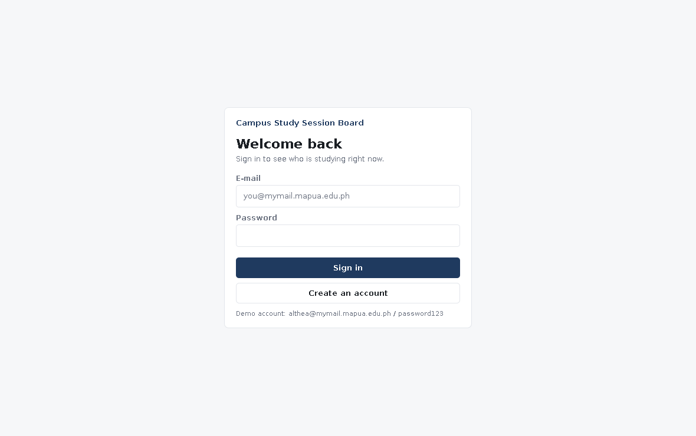
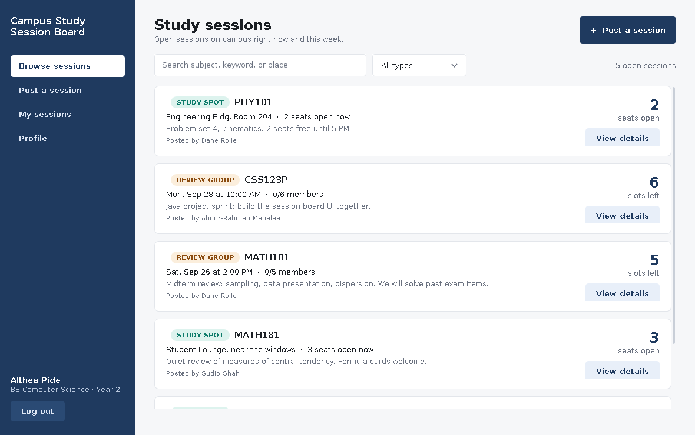
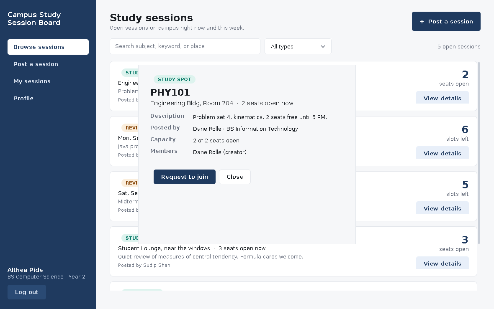
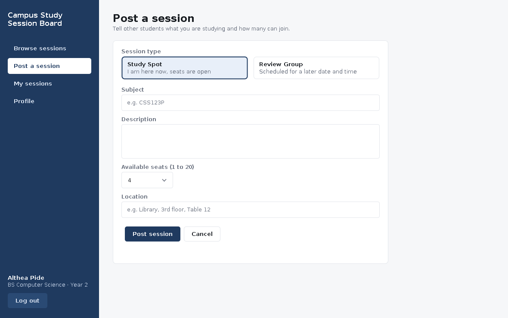
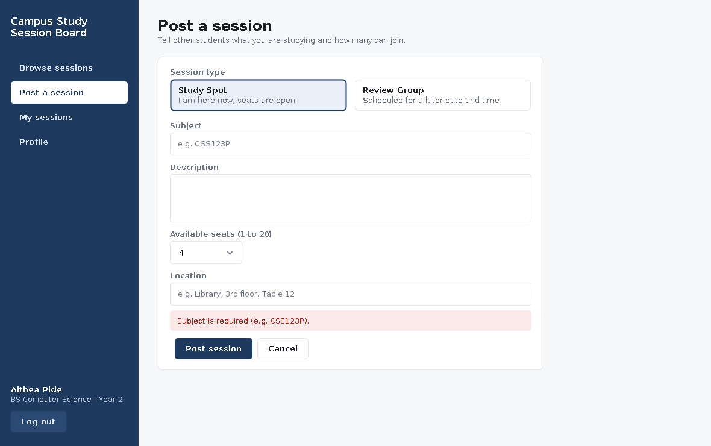
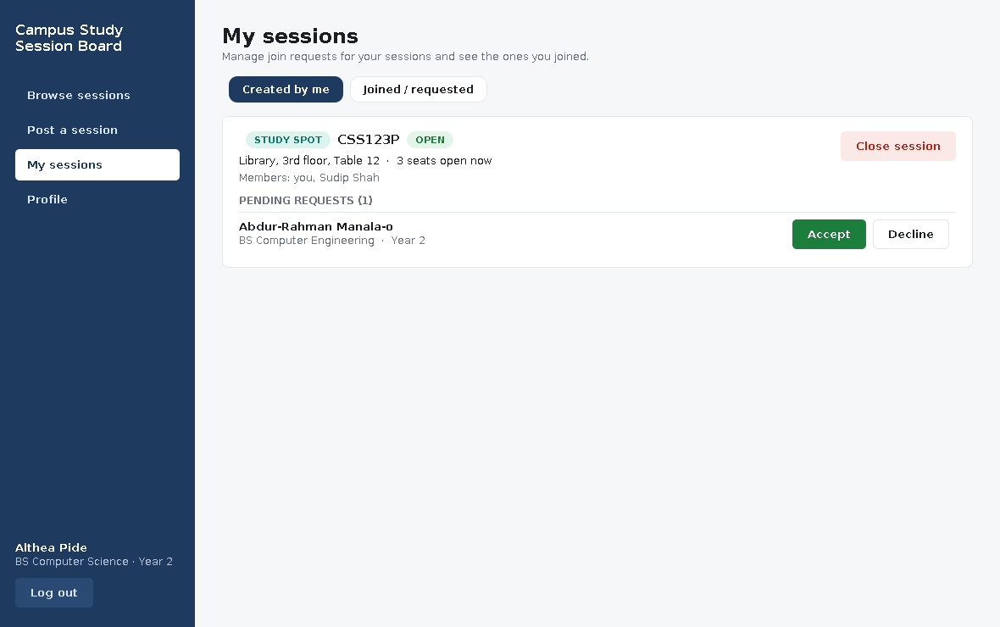
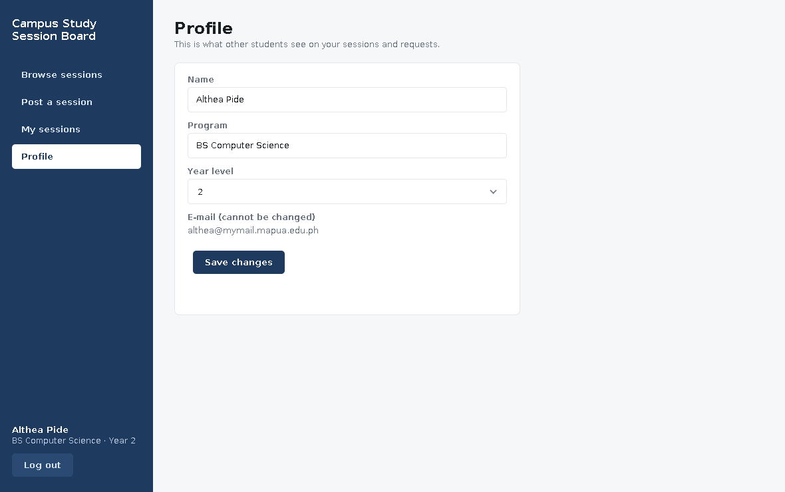

# Campus Study Session Board

**Campus Study Session Board** is a collaborative platform designed to help students connect and study together. The application allows users to create or join both physical and virtual academic sessions, making it easy to find study partners and prepare for exams.

The system is fully connected to a database to keep track of user accounts, available slots, and scheduled times.


## 🚀 Features

* **In-Person Study Sessions:** Create or join on-campus study groups with real-time tracking of available seating/spots at specific campus locations.
* **Online Review Sessions:** Create or join virtual review rooms where students can test each other on a specific subject at a designated time.
* **Real-Time Updates:** Instant synchronization across the app when a student joins or leaves a session.
* **Interactive Scheduling System:** Easily set dates, times, and manage available slot capacities.
* **User Authentication & Profiles:** Secure login system with personalized student profiles.


## 🛠️ Application Previews

Below are the interfaces and workflows of the application:

### 1. User Authentication


### 2. Main Board & Dashboard


### 3. Session Details & Selection


### 4. Creating/Posting a Session



### 5. My Sessions & User Profiles



## 📦 Installation & Setup

Setting up the project locally is straightforward. No complex dependency installations are required:

1. **Clone or download** this repository to your local machine.
2. Navigate into the project folder using your terminal, IDE, or file explorer.
3. Move into the source directory:
   ```bash
   cd src
   ```
4. Open and run **`MainFrame.java`** using your preferred Java IDE (such as Eclipse, IntelliJ IDEA, or NetBeans) or compile it directly from your terminal.


## 🗄️ Database Integration

This application relies on a connected database backend to persist:
* Student profile data and authentication credentials.
* Active study and review session schedules.
* Live seat availability and enrollment metrics.


## 📝 License
This project is developed for campus academic use.